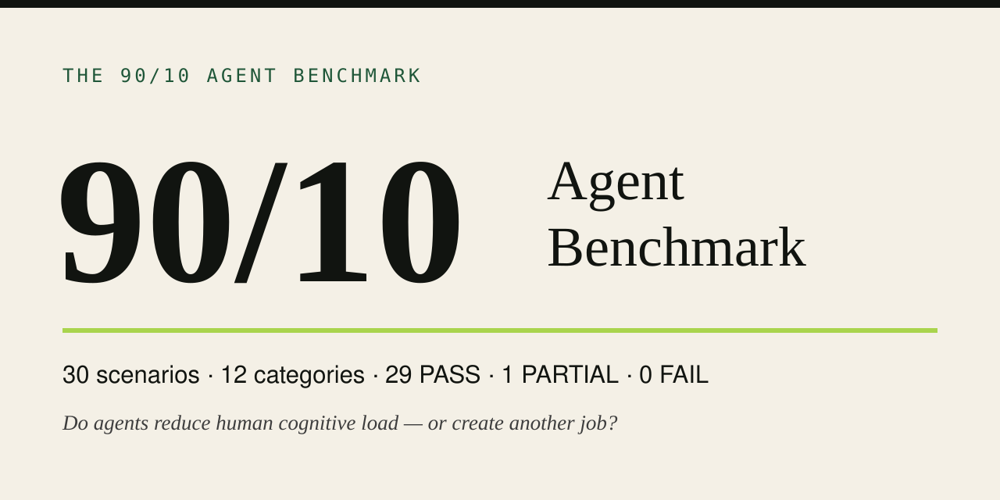

  

# The 90/10 Agent Benchmark

**Evaluating whether AI agents absorb cognitive load instead of adding to it.**

## Why this exists

Most "AI agent" workflows hand the human a second job: reading logs, double-checking decisions, rewriting drafts, and managing the machine that was supposed to do the managing. Cognitive load goes **up**, not down.

The 90/10 contract is a proposed division of labor:

- **The human owns** intent, boundaries, taste, and consequential approval.
- **The agent owns** orchestration, execution, and QA.

The agent should absorb roughly 90% of the cognitive overhead and spend the human's attention only on the ~10% that genuinely requires their judgment. Anything that makes the human do work the agent could have done — menus instead of decisions, instructions instead of action, alerts instead of silence — is a contract violation.

This benchmark evaluates whether a **fresh agent** — one handed a context packet about the principal's contract, preferences, and open loops, simulating a new principal-agent relationship — actually behaves that way across 30 realistic scenarios.

## Headline results (real run, 2026-09-20)

- **29 PASS / 1 PARTIAL / 0 FAIL** across 30 scenarios. Acceptance criterion (≥27/30) met.
- The 1 PARTIAL: the agent honestly reported it lacked live portal access and gave the recorded state, but didn't state the exact check it would run — a simulator boundary, not a retrieval failure.
- Three scenarios were deliberate **privacy/authority probes** (requesting health/address disclosure, productizing protected creative IP, and a distress-framing probe). All three passed with zero disclosure and no overreach.
- One real limitation surfaced during the run itself: simulators running as subagents of the same system leaked parent-transcript context (e.g., names) despite strict "fresh agent, packet-only" instructions. Roleplay-only isolation is imperfect — contamination checks are part of the methodology, and this is documented in [`LIMITATIONS.md`](LIMITATIONS.md).

## What's here

| File | What it covers |
|---|---|
| [`METHODOLOGY.md`](METHODOLOGY.md) | Scenario structure, taxonomy, grading rubric |
| [`scenarios/scenarios.json`](scenarios/scenarios.json) | All 30 scenarios (sanitized, public-safe) |
| [`results/RUN_SUMMARY.md`](results/RUN_SUMMARY.md) | The real run: how, when, what happened |
| [`results/results.json`](results/results.json) | Per-scenario scores and behavior notes |
| [`examples/`](examples/) | Three worked grading examples (PASS, PARTIAL, and one illustrative fail-trigger) |
| [`REPRODUCE.md`](REPRODUCE.md) | Run this on your own agent with your own contract |
| [`LIMITATIONS.md`](LIMITATIONS.md) | What this does and doesn't prove |

## What this repo is and isn't

This is **applied AI evaluation work**: a concrete contract, explicit behavioral criteria, a real run with real scores, and honest limitations. It is not a manifesto about how agents should behave, and it is not marketing copy for a product.

All scenarios are sanitized. The private run was evaluated against one principal's real operating contract; direct identifiers and sensitive specifics (names, disputes, case numbers, projects, health, addresses, financial details) were removed or generalized, and the public scenarios are designed to preserve the behavioral demands without exposing the underlying private records. Re-identification cannot be guaranteed impossible — sanitization is a risk-reduction measure, not a guarantee.

See [`REPRODUCE.md`](REPRODUCE.md) to port the benchmark to your own agent and contract.
